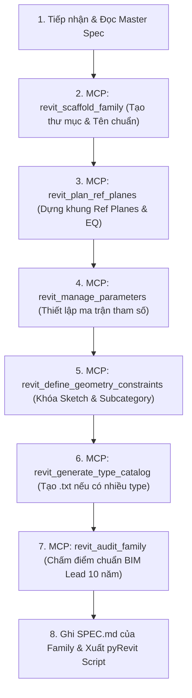

# TIÊU CHUẨN VÀNG KHỞI TẠO FAMILY REVIT (BIM MASTER SPECIFICATION)
> **Phiên bản**: 2.0 - Tiêu chuẩn Giám đốc / Chuyên gia BIM 10+ năm kinh nghiệm (ISO 19650 / NBS BIM Standard)  
> **Áp dụng**: Tất cả các phiên Chat AI tạo lập Family thuộc mọi chuyên ngành (AR, ST, MEP, Cảnh quan, Thiết bị chuyên dụng).  
> **Nguyên tắc**: Bất kỳ phiên chat mới nào cũng PHẢI đọc và tuân thủ 100% tài liệu này. Không được tự ý cắt giảm các bước kiểm soát khung xương và tham số.

---

## 1. TÔN CHỈ CỐT LÕI CỦA BIM SPECIALIST 10 NĂM KINH NGHIỆM

```
┌────────────────────────────────────────────────────────────────────────┐
│                      TRIẾT LÝ VÀNG FAMILY REVIT                        │
│                                                                        │
│   [THAM SỐ]  ──────►  [REFERENCE PLANES]  ──────►  [HÌNH HỌC GEOMETRY]  │
│   (Parameters)         (Hệ khung xương)            (Sketch Lines)      │
│                                                                        │
│   1. Tham số ĐIỀU KHIỂN Reference Planes qua Dimensions.              │
│   2. Reference Planes ĐIỀU KHIỂN Hình học qua Align & Lock (🔒).       │
│   3. TUYỆT ĐỐI KHÔNG khóa trực tiếp Hình học vào Hình học.             │
│   4. Flex Test sau MỖI BƯỚC dựng khung xương trước khi vẽ khối 3D.     │
│   5. 2D Ký hiệu (Symbolic) cho Mặt bằng, ẩn khối 3D thô ở Coarse View. │
└────────────────────────────────────────────────────────────────────────┘
```

---

## 2. QUY CHUẨN CẤU TRÚC THƯ MỤC THƯ VIỆN & TÊN GỌI (TAXONOMY)

### 2.1. Cấu trúc Cây Thư mục Dự án Chuẩn
Kho thư viện Family luôn được tổ chức theo cây phân cấp logic:
```text
revit_library/
├── 01_Architecture/
│   ├── Doors/
│   │   └── BIM_AR_Door_SingleFlush_WallHost_LOD350/
│   │       ├── BIM_AR_Door_SingleFlush_WallHost_LOD350.rfa
│   │       ├── Types/
│   │       │   └── BIM_AR_Door_SingleFlush_WallHost_LOD350.txt (Type Catalog)
│   │       ├── Documentation/
│   │       │   └── SPEC.md (Đặc tả chi tiết từng thông số & kết quả Flex Test)
│   │       ├── Scripts/
│   │       │   └── create_family.py (pyRevit script tự động sinh family)
│   │       └── family_manifest.json
│   ├── Windows/
│   └── Furniture/
├── 02_Structure/
│   ├── Columns/
│   └── Framing/
└── 03_MEP/
    ├── Mechanical_Equipment/
    ├── Electrical_Equipment/
    └── Plumbing_Fixtures/
```

### 2.2. Quy chuẩn Đặt tên Family (ISO 19650 / NBS)
Tên Family phải phản ánh đầy đủ thông tin nhận dạng mà không cần mở file:
$$\text{[Originator]}\_\text{[Discipline]}\_\text{[Category]}\_\text{[Descriptor]}\_\text{[Host]}\_\text{[LOD]}$$

- **Originator**: Mã đơn vị/công ty (vd: `BIM`, `VCC`, `HOK`).
- **Discipline**:
  - `AR`: Architecture (Kiến trúc)
  - `ST`: Structure (Kết cấu)
  - `ME`: Mechanical (HVAC/Điều hòa không khí/Thông gió)
  - `EE`: Electrical (Hệ thống Điện/Chiếu sáng)
  - `PL`: Plumbing (Cấp thoát nước)
  - `FP`: Fire Protection (PCCC)
- **Category**: Tên Revit Category viết liền không dấu (`Door`, `Window`, `Pump`, `Furniture`, `AirTerminal`).
- **Descriptor**: Mô tả hình dáng/tính năng chính (`SingleFlush`, `CentrifugalEndSuction`, `CasementDouble`).
- **Host**: Kiểu gắn (`Unhosted`, `WallHost`, `FloorHost`, `CeilingHost`, `FaceHost`).
- **LOD**: Mức độ chi tiết thông tin (`LOD200`, `LOD300`, `LOD350`, `LOD400`).

*Ví dụ chuẩn*:
- `BIM_AR_Door_SingleFlush_WallHost_LOD350`
- `BIM_ME_Pump_EndSuction_Unhosted_LOD350`
- `BIM_PL_Fixture_WallMountedBasin_FaceHost_LOD300`

---

## 3. QUY CHUẨN HỆ KHUNG XƯƠNG (REFERENCE PLANES SKELETON)

Hệ Reference Planes là linh hồn của Family. Mọi sai sót ở bước này sẽ làm vỡ Family khi nạp vào dự án.

| Tên Mặt phẳng Tham chiếu | View làm việc | Thuộc tính `IsReference` | Khóa Gốc (`Defines Origin`) | Chức năng Kỹ thuật |
| :--- | :--- | :--- | :--- | :--- |
| **Center (Front/Back)** | Floor Plan (Ref. Level) | **Defines Origin** | **CÓ (True)** | Cố định trục tọa độ $Y=0$. Đặt làm tâm đối xứng trước/sau. |
| **Center (Left/Right)** | Floor Plan (Ref. Level) | **Defines Origin** | **CÓ (True)** | Cố định trục tọa độ $X=0$. Đặt làm tâm đối xứng trái/phải. |
| **Ref. Level** | Elevation (Front) | **Defines Origin** | **CÓ (True)** | Cố định cao độ sàn $Z=0$. |
| **Ref_Width_Left** | Floor Plan | Strong Reference | Không | Mép biên trái. Bắt điểm (Snap) & đo kích thước ngoài dự án. |
| **Ref_Width_Right** | Floor Plan | Strong Reference | Không | Mép biên phải. Bắt điểm (Snap) & đo kích thước ngoài dự án. |
| **Ref_Depth_Front** | Floor Plan | Strong Reference | Không | Mặt trước tổng thể. |
| **Ref_Depth_Back** | Floor Plan | Strong Reference | Không | Mặt sau tổng thể. |
| **Ref_Height_Top** | Front Elevation | Strong Reference | Không | Giới hạn chiều cao tổng thể, gán tham số `Height`. |
| **Ref_Frame_Offset...** | Floor Plan / Elevation | Weak Reference / Not a Ref | Không | Dóng vị trí khung bao, độ dày panel, khe hở. Không gây vướng khi bắt điểm trong dự án. |

### Nguyên tắc Khóa Đối xứng (=EQ=):
- Luôn tạo 1 Dimension 3 điểm: `[Ref_Width_Left] ──── [Center (Left/Right)] ──── [Ref_Width_Right]`.
- Bấm biểu tượng **`EQ`** để khóa đối xứng.
- Tạo tiếp 1 Dimension tổng từ `[Ref_Width_Left]` đến `[Ref_Width_Right]` và gán tham số `Width`.
- Tương tự cho phương `Depth`.

---

## 4. QUY CHUẨN MA TRẬN THAM SỐ (PARAMETER MATRIX)

### 4.1. Phân định Type Parameter vs Instance Parameter
- **Type Parameter** (Tham số Kiểu): Áp dụng cho các thuộc tính kích thước tiêu chuẩn, mã hiệu vật tư, nhà sản xuất (khi thay đổi, tất cả phần tử cùng type trong dự án đều đổi theo).
  - *Ví dụ*: `Width`, `Height`, `Depth`, `Frame_Thickness`, `Model_Code`, `Manufacturer`.
- **Instance Parameter** (Tham số Thực thể): Áp dụng cho các đặc tính thay đổi trên từng cá thể riêng biệt trong mặt bằng.
  - *Ví dụ*: `Mark`, `Comments`, `Sill_Height`, `Flip_Swing` (Yes/No), `Fire_Rating_Tag`.

### 4.2. Nhóm Thuộc tính (Parameter Groupings)
- `Dimensions`: Toàn bộ tham số kích thước mm.
- `Materials and Finishes`: Toàn bộ tham số vật liệu (`Material_Main`, `Material_Glass`, `Material_Frame`).
- `Graphics`: Các tham số Yes/No bật tắt hiển thị nét 2D, chi tiết phụ.
- `Identity Data`: Thông tin nhận diện BIM (`OmniClass`, `UniFormat`, `Model`, `Manufacturer`, `URL`).
- `Constraints`: Các tham số phụ trợ hoặc công thức toán học khống chế.

### 4.3. Cú pháp & Quy chuẩn Công thức Revit Formula (Bắt buộc kiểm tra)
- **Cấu trúc hàm điều kiện**:
  $$\text{if}(\text{Condition}, \text{Result\_If\_True}, \text{Result\_If\_False})$$
- **Hàm logic**:
  - `and(A, B)` *(KHÔNG dùng ký hiệu `&&`)*
  - `or(A, B)` *(KHÔNG dùng ký hiệu `||`)*
  - `not(A)` *(KHÔNG dùng ký hiệu `!`)*
  - Phép so sánh: `=`, `>`, `<`, `>=`, `<=` *(KHÔNG dùng `==`)*
- **Kiểm soát giá trị an toàn (Chống phá vỡ hình học)**:
  - Giới hạn kích thước tối thiểu: `Width_Safe = if(Width < 600 mm, 600 mm, Width)`
  - Tính toán số lượng nan chớp/bước chia: `Louver_Count = round((Height - 100 mm) / Spacing)`
  - Tính mở góc cánh cửa 2D: `Swing_Angle = if(Open_Angle > 180°, 180°, Open_Angle)`

---

## 5. QUY CHUẨN RÀNG BUỘC HÌNH HỌC (GEOMETRY CONSTRAINTS)

1. **Khóa Sketch Line vào Reference Plane (Align & Lock 🔒)**:
   - Khi vẽ phác thảo (Sketch mode) của Extrusion hoặc Sweep: Dùng lệnh `Align` (`AL`) mặt phẳng tham chiếu trước, nét phác thảo sau, rồi bấm biểu tượng **Khóa (🔒)** ngay lập tức.
2. **Khóa Chiều cao Đùn (Extrusion Start / End)**:
   - Chuyển sang Elevation view. Align đáy khối với `Ref. Level` (khóa 🔒) và đỉnh khối với `Ref_Height_Top` (khóa 🔒).
   - Tuyệt đối không để giá trị Extrusion End cố định trong Properties.
3. **Phân bổ Subcategories**:
   - Toàn bộ khối hình học phải thuộc Subcategory riêng biệt (vd: Cửa đi có `Frame/Mullion`, `Panel`, `Glass`, `Hardware`).
   - Giúp người dùng quản lý màu sắc, vật liệu và nét in từ `Object Styles` hoặc `Visibility/Graphic Overrides` của dự án mà không cần sửa file family.
4. **Hiệu năng Đồ họa 2D/3D (Graphic Performance)**:
   - Trong `Visibility Settings` của khối 3D thô: **Bỏ tích chọn `Plan/RCP` và bỏ tích `Coarse`**.
   - Vẽ đường nét ký hiệu 2D (`Symbolic Lines`) trên mặt bằng với Subcategory `Plan Swing` hoặc `Hidden Lines`. Khi xem mặt bằng tỉ lệ 1/100, Revit chỉ vẽ các nét 2D nhẹ, giữ dự án mượt mà 60 FPS!

---

## 6. QUY CHUẨN TYPE CATALOG (.TXT) CHO DÒNG SẢN PHẨM NHIỀU KÍCH THƯỚC

Nếu Family có từ 5 Types trở lên, PHẢI tạo file Type Catalog `.txt` đi kèm cùng tên và đặt cùng thư mục để người dùng chỉ tải đúng kích thước mong muốn vào công trình.

*Cấu trúc Header chuẩn Revit Catalog*:
```csv
,Width##length##millimeters,Height##length##millimeters,Depth##length##millimeters,Fire_Rating##other##
Type_01_800x2100,800,2100,100,FR30
Type_02_900x2100,900,2100,100,FR60
Type_03_1000x2100,1000,2100,100,FR60
Type_04_1200x2400,1200,2400,150,FR90
```

---

## 7. QUY TRÌNH TẠO FAMILY BẰNG CHAT (WORKFLOW CHO TỪNG PHIÊN CHAT)

Mỗi khi người dùng tạo một phiên chat mới cho một nhóm hoặc một Family cụ thể, Agent trong phiên chat đó PHẢI thực hiện tuần tự 8 bước sau:



### Chi tiết các bước thực hiện trong phiên Chat:
- **Bước 1**: Đọc tài liệu này (`BIM_REVIT_FAMILY_MASTER_SPEC.md`) để nạp toàn bộ quy chuẩn vào ngữ cảnh.
- **Bước 2**: Sử dụng tool MCP `revit_scaffold_family` để thiết lập thư mục và chuẩn hóa tên file theo ISO 19650.
- **Bước 3**: Sử dụng tool MCP `revit_plan_ref_planes` để sinh sơ đồ mặt phẳng tham chiếu, định vị gốc tọa độ và ràng buộc đối xứng.
- **Bước 4**: Sử dụng tool MCP `revit_manage_parameters` để validate bảng tham số và công thức Revit Formula.
- **Bước 5**: Sử dụng tool MCP `revit_define_geometry_constraints` kiểm soát ràng buộc hình học và phân tách hiển thị 2D/3D.
- **Bước 6**: Sử dụng tool MCP `revit_generate_type_catalog` để sinh file catalog nếu có trên 4 biến thể.
- **Bước 7**: Chạy tool MCP `revit_audit_family` kiểm toán chất lượng. Chỉ nghiệm thu khi đạt điểm **A+ (≥ 90/100)**.
- **Bước 8**: Áp dụng skill `md-maintainer` để ghi đầy đủ hồ sơ kỹ thuật vào file `SPEC.md` tại thư mục của Family đó, đồng thời xuất file script Python (`Scripts/create_family.py`) để người dùng chạy ngay trong Revit.

---

## 7.3. KẾT NỐI TRỰC TIẾP VỚI REVIT 2022 (LIVE MCP BRIDGE)

Hệ thống đã tích hợp Add-in bản quyền 2 chiều dành riêng cho **Autodesk Revit 2022**:
- **Tệp cài đặt Add-in**: `C:\ProgramData\Autodesk\Revit\Addins\2022\RevitFamilyMcpBridge.addin`
- **Thư viện thực thi DLL**: `C:\ProgramData\Autodesk\Revit\Addins\2022\RevitFamilyMcpBridge\RevitFamilyMcpBridge.dll`
- **Cơ chế hoạt động**:
  1. Khi mở **Revit 2022**, Add-in tự động kích hoạt máy chủ HTTP nội bộ bảo mật tại `http://127.0.0.1:4848/`.
  2. Trên thanh Ribbon của Revit 2022 xuất hiện Tab **"BIM AI"** với các nút chức năng: `Bridge Status (Port 4848)`, `Restart Bridge`, `Open Family Library`.
  3. AI Assistant kết nối trực tiếp với Revit qua tool MCP `revit_live_bridge`:
     - Tự động kiểm tra trạng thái Revit 2022 đang mở tài liệu nào.
     - Đẩy trực tiếp hệ Reference Planes, Parameters và Dimensions vào phiên làm việc Revit 2022 theo thời gian thực (Real-time Construction) thông qua Revit API `ExternalEvent`.
     - Thực hiện **Flex Test tự động trực tiếp trên Revit 2022** và báo cáo ngay nếu có bất kỳ lỗi ràng buộc (Constraint Over-defined) nào phát sinh!

---

## 8. BẢNG CHECKLIST NGHIỆM THU CHUẨN BIM LEAD (BẮT BUỘC CHECK TRONG MỖI CHAT)

Mỗi phiên chat khi hoàn thiện Family phải xuất bảng checklist này và đánh dấu `[x]` toàn bộ:

- [ ] **1. Tên & Thư mục**: Đã đặt tên theo chuẩn ISO 19650 (`[Originator]_[Discipline]_[Category]_[Descriptor]_[Host]_[LOD]`) và lưu đúng thư mục phân cấp.
- [ ] **2. Tọa độ Gốc (Origin)**: Có đủ 2 Ref Planes tâm (Front/Back và Left/Right) và Ref Level được khóa thuộc tính "Defines Origin".
- [ ] **3. Đối xứng & Cân bằng**: Đã ràng buộc bằng kích thước `=EQ=` cho các phương đối xứng.
- [ ] **4. Snapping & Dim ngoài dự án**: Các mép biên bao ngoài được gắn `Strong Reference`; các đường phụ bên trong là `Weak Reference` hoặc `Not a Reference`.
- [ ] **5. Ma trận Tham số**: Phân định chính xác Type vs Instance; gán đúng nhóm thuộc tính; không chứa công thức tham chiếu vòng tròn.
- [ ] **6. Tham số Vật liệu**: Đã tạo ít nhất 1 tham số kiểu Material để dự án có thể đổi chất liệu.
- [ ] **7. Ràng buộc Khóa (Lock 🔒)**: 100% đường bao sketch lines và cao độ Extrusion được khóa vào Reference Planes (không khóa vào hình học khác).
- [ ] **8. Subcategories**: Đã gán Subcategory cụ thể cho từng khối Solid/Void.
- [ ] **9. Hiệu năng Viewport**: Khối 3D thô đã được ẩn ở mặt bằng Coarse View; đã thiết lập đường nét ký hiệu 2D (`Symbolic Lines`).
- [ ] **10. Flex Test An toàn**: Đã thử nghiệm thay đổi kích thước từ cực tiểu (-50%) đến cực đại (+100%) mà không làm đứt gãy hình học.
- [ ] **11. Type Catalog**: Đã xuất file `.txt` tương thích nếu có nhiều hơn 4 type.
- [ ] **12. Đồng bộ Markdown**: Toàn bộ thông số, kết quả test và hướng dẫn chạy script pyRevit đã được ghi đầy đủ vào tệp `SPEC.md` của Family.
